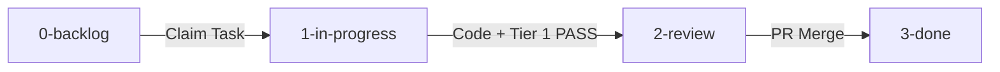

# Product Management as Code (PM-as-Code)

A version-controlled, repository-native system for managing roadmaps, PRDs, and agent execution tasks alongside source code using Markdown.

---

## 1. Core Philosophy: Why PM-as-Code?

Traditional issue tracking systems (Jira, Linear, Asana) fail in AI-agentic development workflows because of **context disconnection**:
1. **Disconnected History:** Tickets live on external cloud servers, invisible to git branches and git diffs.
2. **Context Loss on PR:** An agent reviewing code on a git branch cannot see acceptance criteria without external API access or copy-pasted prompts.
3. **Branch Drift:** Tasks advance to "Done" in Jira while the branch is still unmerged or failing CI.

### The PM-as-Code Invariant
> **Tasks, acceptance criteria, and code live in the exact same git repository and are modified atomically in the same pull request.**

When an agent moves `TASK-001.md` from `1-in-progress/` to `2-review/`, that movement is committed to git. Reviewers, CI workflows, and future agents can inspect the task requirements directly from the repository filesystem.

---

## 2. Directory Layout

Every adopting repository maintains a `pm/` root folder:

```text
pm/
├── areas.json                        # Map of repository domains, paths, and tech stack
├── KANBAN.md                         # Auto-generated task board across all features
├── ROADMAP.md                        # Auto-generated feature release table
├── standards/                        # Governing review contracts and reviewer specifications
│   ├── AGENT_REVIEW_CONTRACT.md
│   ├── TIER_1_REVIEWER_SPEC.md
│   └── schemas/review-verdict.schema.json
├── templates/                        # Scaffolding templates
│   ├── prd-template.md
│   └── task-template.md
└── features/                         # Active initiatives
    └── FEAT-[ID]-[slug]/
        ├── prd.md                    # Feature PRD & architectural requirements
        └── tasks/
            ├── 0-backlog/            # Tasks planned / pending assignment
            ├── 1-in-progress/        # Active tasks being coded
            ├── 2-review/             # Tasks with open PR / under Tier 1 review
            └── 3-done/               # Completed & merged tasks
```

---

## 3. Initiative Prefixes

Initiatives are classified under `pm/features/` with standardized prefixes:

| Prefix | Category | Purpose | Examples |
| :--- | :--- | :--- | :--- |
| **`FEAT-`** | **Product Features** | User-facing capabilities, sync pipelines, core modules. | `FEAT-001 Sync CLI`, `FEAT-005 Two-Tier Review` |
| **`INFRA-`** | **Engineering Enablers** | CI/CD pipelines, GitHub Actions, deployment configurations. | `INFRA-001 Pages Pipeline` |
| **`TECH-`** | **Tech Debt & Polish** | Refactoring, styling tokens, performance optimization, SEO. | `TECH-001 Tailwind v4 Tokens` |

---

## 4. The 4-Stage Task Lifecycle



1. **`0-backlog/`:** Planned tasks waiting for resource availability.
2. **`1-in-progress/`:** Assigned to an agent or developer. Work is underway on a dedicated branch.
3. **`2-review/`:** Code is written, deterministic checks pass, Tier 1 subagent verdict is `PASS`, and a PR is open.
4. **`3-done/`:** The PR is approved and merged into `main` by a human maintainer.
