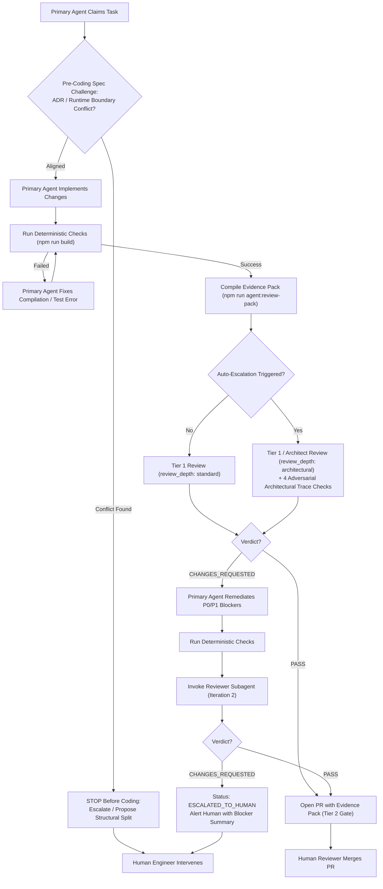

# Agent Review Contract & Severity Taxonomy Specification

**Version:** 1.2.0  
**Status:** Canonical  
**Applies to:** Universal (Portfolio, PlateMark, MAKER, CommuteShift, and all agentic repositories)  
**Governing Standard:** Two-Tier Agentic Review Model  

---

## 1. Purpose & Principles

This contract establishes a deterministic, objective standard for automated AI code reviews. In an agentic software development workflow, code review by an independent agent must prevent **confirmation bias**, **architectural coupling**, **test theater**, and **hallucinated nitpicking** while enforcing uncompromising rigor on functionality, security, architectural boundaries, and acceptance criteria.

### Core Tenets

1. **Deterministic Priority:** An LLM review must **never** run on code that fails deterministic checks (compilation, type checks, linting, tests). Deterministic tools fail fast and cost zero tokens.
2. **Pre-Coding Spec Challenge:** Before writing any code, the primary coding agent must validate task instructions against repository Architecture Decision Records (ADRs) and runtime/trust boundaries (`client` vs. `server` vs. `edge` vs. `cli`). If a task specification prescribes a pattern that conflicts with an ADR or couples incompatible runtime boundaries, the agent must **stop before coding** and escalate or propose a structural split rather than shipping a workaround.
3. **Objective Auto-Escalation (`standard` vs. `architectural`):** Review depth scales deterministically based on `pm/areas.json` risk metadata and diff heuristics. Touching high-risk or structural-boundary areas, modifying runtime/auth/env/DB/CI entrypoints, or introducing static source-text regex tests automatically elevates the review to `review_depth: "architectural"`.
4. **Proof-of-Defect:** No finding may be reported without an exact code reference, a concrete failure scenario or violated criterion, and an actionable remediation snippet. Abstract commentary (e.g. *"consider improving modularity"*) is strictly forbidden.
5. **Bounded Iteration:** The review loop between the primary coding agent and reviewer subagent is capped at **maximum 2 iterations**. If blocking defects cannot be resolved in two passes, the task escalates to human review to prevent token exhaustion.
6. **Separation of Concerns:**
   - **Tier 1 (Inner Loop / Pre-PR):** Fresh-context subagent reviews the diff against local acceptance criteria, area boundaries, and (when escalated) the adversarial architectural rubric before PR creation.
   - **Tier 2 (Outer Loop / PR Gate):** Automated GitHub Actions CI workflow audits the PR evidence pack, verifies architectural review attestations when escalation triggers apply, and executes the remote deterministic test matrix for human merge sign-off.

---

## 2. Severity Taxonomy

Every finding produced by a reviewer agent must be categorized into exactly one of three severity levels:

| Severity | Label | Merge Impact | Auto-Fix Loop Trigger | Description & Triggers |
| :--- | :--- | :--- | :--- | :--- |
| **`P0`** | **Blocker** | **BLOCKS** | **Yes (Mandatory)** | Deterministic failure, violated acceptance criteria, runtime crash, non-atomic data corruption, fail-open security/production bypass, or security vulnerability. |
| **`P1`** | **High** | **BLOCKS** | **Yes (Mandatory)** | Scope/boundary violation (`pm/areas.json`), import-time runtime coupling, fail-open default parameters, non-atomic multi-step writes, test theater (`readFileSync` + regex on app source), unchallenged ADR/spec conflict, missing error boundary, or broken API contract. |
| **`P2`** | **Nit / Suggestion** | **DOES NOT BLOCK** | **No (Optional)** | Non-blocking readability suggestions, style suggestions, or optional micro-optimizations. |

---

### Detailed Severity Definitions

#### P0: Blocker (Mandatory Fix Required)
A P0 finding represents an unconditional stop-ship defect. If any P0 finding exists, the review verdict is `CHANGES_REQUESTED`.

**Qualifying Conditions:**
- **Deterministic Check Failure:** TypeScript compilation errors, build failures, or failing automated unit/integration tests.
- **Acceptance Criteria Failure:** Any explicitly checked or required criterion in the task or parent PRD that is not satisfied or is partially implemented.
- **Unhandled Runtime Exceptions:** Unhandled promise rejections, unchecked `null`/`undefined` property accesses in core paths, or unvalidated user inputs causing crashes.
- **Data Loss / State Corruption:** Inconsistent writes to database or file storage, non-atomic multi-step mutations that corrupt state on partial failure, race conditions causing state overwrites, or broken AST manipulation that corrupts markdown files.
- **Security Vulnerabilities & Fail-Open Production Guards:** Hardcoded API keys or secrets, path traversal vectors (`../`), cross-site scripting (XSS), SQL injection, unescaped HTML injection, or fail-open security/production safeguards that silently bypass enforcement when parameters are omitted.

#### P1: High (Mandatory Fix Required)
A P1 finding represents an architectural, boundary, or stability violation that degrades maintainability or introduces hidden regressions. If any P1 finding exists, the review verdict is `CHANGES_REQUESTED`.

**Qualifying Conditions:**
- **Boundary Violation:** Modifying files outside the task's declared `target_paths` or outside the area scopes defined in `pm/areas.json` without documented justification.
- **Import-Time Side Effects & Runtime Profile Coupling:** Module-top-level execution that couples incompatible runtime profiles—such as importing a shared database client or utility inside a standalone CLI script, edge function, or client bundle that triggers eager web-server environment variable validation, opens connection pools at import time, or leaks server-only modules.
- **Fail-Open Default Parameters & Negative-Path Bypass:** Using permissive default parameters (e.g., `nodeEnv = ""` or fallback defaults) that silently skip production or security safeguards when callers omit arguments or execute under non-default runtime modes (e.g., `NODE_ENV=production` CLI execution) instead of failing closed with an actionable error.
- **Non-Atomic Multi-Step Persistence:** Executing sequential multi-statement database or file writes across separate calls without an atomic transaction boundary, rollback/compensation logic, or idempotency handling.
- **Test Theater (Static Source-Text Matching):** Unit or integration tests that purport to verify runtime behavior, guards, or business invariants by reading application source files as strings (`fs.readFileSync`, `fs.readFile`, etc.) and matching regular expressions or substrings instead of exercising runtime execution (unless the test is explicitly scoped to static configuration or schema validation).
- **Unchallenged Spec / ADR Boundary Conflict:** Blindly implementing a contradictory task instruction that violates a repository ADR or runtime/trust boundary (`client` vs. `server` vs. `edge` vs. `cli`) via a fragile workaround instead of halting and escalating pre-coding.
- **Missing Error Handling on I/O:** Unhandled network timeouts, missing fallback for missing files, or swallowed errors that hide systemic failures.
- **API Contract Breakage:** Modifying existing exported functions, interfaces, or CLI flags in a backwards-incompatible manner without deprecation or migration handling.
- **Unchecked Edge Cases:** Failing to handle empty arrays, empty strings, zero values, or maximum length payloads when processing dynamic external inputs.
- **Environment Variable Parity:** Any code referencing `process.env.<VAR_NAME>` where `<VAR_NAME>` is not documented with a safe default or placeholder in `.env.example`.
- **Zero-Config Local Dev Violation:** Introducing third-party cloud services or external credentials without an autonomous local dev fallback (e.g., local mock, dev bypass, or clear in-UI configuration guidance banner when credentials are unset).
- **Hardcoded Localhost in Client Code:** Using absolute `http://localhost:<port>` URLs in client-side code instead of relative endpoints or dynamic origin (`window.location.origin`), causing cross-origin network errors on non-default ports or IP bindings.

#### P2: Nit / Suggestion (Informational Only)
A P2 finding is an observation or advisory note. P2 findings **never block a merge**, do not count towards the blocker tally, and do not trigger a review loop iteration.

**Qualifying Conditions:**
- Typo in a comment or internal docstring (not user-facing).
- Suggestion to use an alternative idiomatic pattern where the current code is already correct, tested, and readable.
- Informational note on future refactoring opportunities when extending the module.

---

## 3. Objective Auto-Escalation (`standard` vs. `architectural` Review Depth)

To eliminate manual guesswork over when a task requires deeper architectural scrutiny, the review pipeline classifies every change into one of two review depths:
- **`"standard"`**: Default review depth for localized changes within a single standard-risk area that do not touch structural boundaries or critical runtime surfaces.
- **`"architectural"`**: Elevated review depth requiring explicit trace verification across four adversarial architectural axes (either via the expanded architectural Tier 1 rubric or a dedicated fresh-context Senior Architect review pass) before PR preparation succeeds.

### Area Risk Metadata (`pm/areas.json`)

Each area in `pm/areas.json` supports optional risk classification metadata (schema: [`areas.schema.json`](./schemas/areas.schema.json)):
- `risk_tier`: `"standard" | "high"` (defaults to `"standard"`).
- `structural_boundaries`: `string[]` listing architectural or runtime boundaries governed by the area, such as:
  - `env-boot` (environment variable parsing, boot validation, configuration loading)
  - `db-client` (database connection pools, client initialization, transaction helpers)
  - `auth-session` (authentication, session management, authorization guards)
  - `edge-proxy` (edge middleware, request routing, proxy boundaries)
  - `build-ci` (CI workflows, build pipelines, bundler/compiler configs)
  - `cli-entrypoint` (standalone CLI scripts, operational runners, seed/migration entrypoints)
  - `client-server-boundary` (RPC/API serialization, server-only vs. client-bundle isolation)

### Objective Auto-Escalation Triggers

A task is **automatically elevated** to `review_depth: "architectural"` whenever **any** of the following three objective triggers fires:

1. **Area Risk & Cross-Boundary Scope:**
   - Any changed file matches an area in `pm/areas.json` configured with `risk_tier: "high"` or non-empty `structural_boundaries`, **OR**
   - Changed files cross multiple architectural areas or multiple distinct `structural_boundaries`.
2. **Critical Architectural Diff Surfaces:**
   - The diff alters runtime entrypoints (`bin/`, `scripts/`, `cli/`, `server`, `index`, `main`, `instrumentation`), auth/session/middleware modules, environment schemas/validation, database client/pool initialization, build/CI workflows (`.github/workflows/`, `Dockerfile`, compiler/bundler configs), or runtime dependencies (`package.json`, `pyproject.toml`, `Cargo.toml`, `go.mod`).
3. **Static Source-Text Matching in Tests ("Test Theater"):**
   - Changed or added test files read application source files as raw text (`readFileSync`, `readFile`, etc.) paired with regex or string assertions against source code instead of exercising runtime execution.

### Mandatory Adversarial Architectural Checklist (`review_depth: "architectural"`)

Whenever `review_depth` is `"architectural"`, the reviewer must execute and attest to four concrete trace checks in `architectural_checks`:

| Check Key | Trace Requirement | Failure Severity |
| :--- | :--- | :--- |
| **`import_boot_isolation`** | **Import-Time & Boot-Chain Isolation:** Trace top-level imports across the module graph for eager initialization, DB pool creation, eager env validation, or server-only leaks into client, edge, or standalone CLI contexts. | `P0` / `P1` |
| **`fail_closed_defaults`** | **Fail-Closed Defaults & Negative Paths:** Verify missing env vars, empty/omitted parameters (e.g., `nodeEnv = ""`), and non-default runtime modes (e.g., `NODE_ENV=production` CLI execution) fail closed with actionable errors rather than silently skipping checks. | `P0` / `P1` |
| **`write_atomicity`** | **Multi-Step Write Atomicity & Idempotency:** Verify multi-statement persistence flows use atomic transactions and clean partial-failure/rollback handling (`"N/A"` if no persistence writes exist). | `P0` / `P1` |
| **`no_test_theater`** | **Behavioral Test Authenticity (No Test Theater):** Verify unit/integration tests execute runtime code paths (including negative paths) rather than asserting source-file text via `readFileSync` + regex. | `P1` Blocker |

---

## 4. Proof-of-Defect Requirement

To ensure findings are trustworthy and immediately actionable, reviewer subagents must supply concrete proof for every P0 and P1 finding:

```text
Finding Format Requirement:
1. File Path:      Exact relative repository path (e.g. `scripts/sync-projects.ts`)
2. Line Range:     Exact start and end line numbers in the proposed branch diff (e.g. lines 45-52)
3. Criterion / ID: Reference to the violated Acceptance Criterion or architectural rule tag
4. Failure Proof:  A realistic input or scenario triggering the bug (e.g. "Importing db/client.ts from CLI script triggers web-only OAUTH_SECRET validation at module top level")
5. Concrete Fix:   Exact code replacement or diff snippet that resolves the defect
```

### Finding Anti-Patterns (Forbidden Output)

❌ **Forbidden (Abstract Bikeshedding):**
> *"Consider extracting this logic into a helper function for better separation of concerns."*  
> *(Violates proof-of-defect; this is an ungrounded style preference.)*

❌ **Forbidden (Vague Speculation):**
> *"This might fail in production if the network is slow."*  
> *(Violates concrete failure proof; no specific missing timeout or error boundary is cited.)*

✅ **Valid (Proof-of-Defect Compliant — Functional P0):**
> **Severity:** P0  
> **File:** `scripts/agent/synthesize-commits.ts` (L78-L82)  
> **Criterion:** AC-3 ("Zero unhandled null references when git commit list is empty")  
> **Proof:** `gitLog.split('\n')[0].match(...)` throws `TypeError: Cannot read properties of undefined` when `gitLog` is empty string.  
> **Suggested Fix:** Add guard `if (!gitLog?.trim()) return [];` before line 78.

✅ **Valid (Proof-of-Defect Compliant — Architectural P1):**
> **Severity:** P1  
> **Category:** `fail-closed-defaults`  
> **File:** `src/db/seed-guard.ts` (L12-L18)  
> **Criterion:** ARCH-2 ("Fail-Closed Defaults & Negative Paths")  
> **Proof:** `assertSafeEnvironment(nodeEnv = "")` defaults `nodeEnv` to `""`. When invoked as `assertSafeEnvironment()` with `process.env.NODE_ENV === "production"`, `nodeEnv === "production"` evaluates to `false`, silently bypassing the production destructive-write guard.  
> **Suggested Fix:** Resolve `const effectiveEnv = (nodeEnv ?? process.env.NODE_ENV ?? "").trim();` and throw if `effectiveEnv === ""` or `effectiveEnv === "production"`.

---

## 5. Review Verdict Contract & Machine-Readable Schema

Reviewer subagents must format their final review evaluation as structured JSON conforming to [`review-verdict.schema.json`](./schemas/review-verdict.schema.json).

### Verdict States

- **`PASS`**: `blocking_count === 0` (no P0 or P1 findings). When `review_depth === "architectural"`, `architectural_checks` must be present and contain zero `"FAIL"` entries. P2 nits may be present. The branch is cleared for pull request creation and Tier 2 quality gates.
- **`CHANGES_REQUESTED`**: `blocking_count > 0` (at least one P0 or P1 finding) or any `architectural_checks` entry is `"FAIL"`. The primary agent must remediate all blockers and request a re-review (up to iteration 2).
- **`ESCALATED_TO_HUMAN`**: The review has reached the maximum iteration limit (2 passes) and blockers remain unresolved, or a Pre-Coding Spec Challenge identified an unresolvable ADR/boundary conflict. Execution pauses and alerts the human engineer with a structured summary.

### Multi-Iteration Verdict Archiving & Negative-Knowledge Telemetry

- **Active Verdict Path:** `.review/verdict-<task-id>.json` always holds the active/latest review verdict.
- **Prior Iteration Snapshots:** Whenever Iteration 1 returns `CHANGES_REQUESTED` (or before an earlier iteration is overwritten during `verdict` validation, `save`, or `review-pack`), the snapshot is archived non-destructively to `.review/verdict-<task-id>-iter<N>.json` (e.g., `.review/verdict-task-113-iter1.json`).
- **PR Iteration History Rendering:**
  - Single-pass clean PRs (`Iteration 1 PASS`) embed only the active `### Review Verdict` JSON block with zero additional output.
  - Multi-iteration PRs (`Iteration 2 PASS` after `Iteration 1 CHANGES_REQUESTED`) render a collapsed `<details>` Markdown summary (`Review Iteration History`) after the primary `### Review Verdict` ` ```json ` block documenting resolved `P0`/`P1`/`P2` findings from prior iterations without introducing additional ` ```json ` fenced code blocks.

---

## 6. Loop Termination & Escalation Protocol

To maintain high developer velocity, prevent architectural drift, and protect token budgets, the workflow enforces a Pre-Coding Spec Challenge gate and a hard ceiling of two review iterations:


