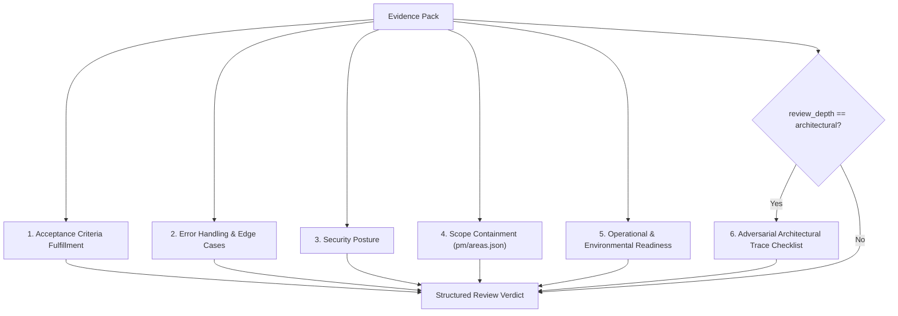

# Tier 1 Fresh-Context Reviewer Subagent Specification

**Version:** 1.2.1  
**Status:** Canonical  
**Applies to:** Antigravity & AI Coding Agents across all repositories  
**Governing Standard:** [`standards/AGENT_REVIEW_CONTRACT.md`](./AGENT_REVIEW_CONTRACT.md)  

---

## 1. Executive Summary & Architecture

The **Tier 1 Reviewer Subagent** is an isolated, read-only AI agent invoked in the inner development loop before code is committed to a pull request.

### The Problem It Solves
When a primary coding agent works on a feature, it accumulates long conversational context, error logs, and trial-and-error reasoning. This creates distinct failure modes in LLMs:
1. **Confirmation Bias / Self-Review Blindness:** The model reviews what it *intended* to do rather than what the code actually does.
2. **Context Pollution:** Residual error logs, hallucinations, and outdated intermediate state degrade reasoning depth.
3. **Shallow Diff-vs-Checklist Matching:** Without adversarial trace obligations, a reviewer may verify that acceptance criteria checkboxes appear satisfied on the happy path while missing import-time runtime coupling, fail-open default parameters, non-atomic multi-step writes, or static regex "test theater."

### The Solution: Isolated Fresh Context + Objective Depth Escalation
The Tier 1 Reviewer Subagent runs with **clean, isolated context**, receiving:
1. The Task Acceptance Criteria and Objective.
2. The Deterministic Verification Results (build & test output).
3. The Clean Unified Git Diff (sanitized against lockfiles & binaries).
4. The Matched Scope Boundaries and Risk Metadata (`risk_tier`, `structural_boundaries`) from `pm/areas.json`.
5. The Computed Review Depth (`review_depth: "standard" | "architectural"`), fired `escalation_triggers`, and any detected `test_theater_suspects`.

```text
┌────────────────────────────────────────────────────────┐
│   Primary Coding Agent                                 │
│   0. Runs Pre-Coding Spec Challenge (ADR & Boundaries) │
│   1. Completes coding & deterministic checks           │
│   2. Runs npm run agent:review-pack <TASK_ID>          │
└──────────────────────────┬─────────────────────────────┘
                           ▼
┌────────────────────────────────────────────────────────┐
│   Evidence Pack (.review/evidence-pack-<id>.md)        │
│   - Computes review_depth: "standard" | "architectural"│
│   - Detects escalation_triggers & test_theater_suspects│
└──────────────────────────┬─────────────────────────────┘
                           │ Fresh invocation with Evidence Pack
                           ▼
┌────────────────────────────────────────────────────────┐
│   Tier 1 / Architectural Reviewer Subagent             │
│   - Zero prior conversation                            │
│   - Read-only tools (can trace imported modules/ADRs)  │
│   - Standard 5 Axes + Adversarial Architectural Rubric │
│   - Strict Schema Output (review-verdict.schema.json)  │
└──────────────────────────┬─────────────────────────────┘
                           │ Verdict: PASS or CHANGES_REQUESTED
                           ▼
┌────────────────────────────────────────────────────────┐
│   Primary Coding Agent                                 │
│   - Fixes blockers (Max 2 iterations)                  │
└────────────────────────────────────────────────────────┘
```

---

## 2. Tooling & Permission Boundaries (Least Privilege)

To ensure the review is objective and cannot accidentally tamper with working state, the reviewer subagent operates under strict read-only permissions:

| Permitted Capabilities | Prohibited Capabilities |
| :--- | :--- |
| `read_file` (inspecting source files, imported modules, ADRs, types, config) | `write_file` (modifying repository files) |
| `search_web` / `read_file` (querying documentation) | `edit_file` (altering repository files) |
| Read-only commands (`git diff`, `git log`, `cat`) | Mutating commands (`git commit`, `git push`, `npm install`) |
| Structured JSON Verdict Generation | Unstructured conversational debates |

> [!IMPORTANT]
> The reviewer subagent **never writes fixes directly**. It diagnoses defects, traces cross-module boundaries using `read_file`, and returns actionable remediation snippets to the primary agent.

---

## 3. Core Evaluation Axes

The reviewer subagent audits the branch diff against five mandatory baseline axes on every task, plus a sixth **Adversarial Architectural Rubric** whenever `review_depth` is `"architectural"`:



### Axis 1: Acceptance Criteria Fulfillment
- Check every item in the task specification checklist.
- For each criterion, identify the exact lines in the diff that implement it.
- If a criterion is missing, stubbed with TODOs, or only partially implemented, record a **P0 Blocker**.

### Axis 2: Error Handling & Edge Cases
- **Null / Undefined Safety:** Are optional chained accesses safe? Does passing `undefined`, `null`, or an empty string cause unhandled exceptions?
- **Promise Rejections:** Are async operations wrapped in try-catch blocks or properly propagated?
- **Boundary Conditions:** Are empty arrays, zero counts, and max-length bounds handled cleanly?
- If an unhandled exception or crash condition is found, record a **P0 Blocker**.

### Axis 3: Security Posture
- **Secret Leaks:** Check that no private keys, PAT tokens, or API credentials are hardcoded.
- **Injection & Traversal:** Verify that user inputs or path strings are sanitized against path traversal (`../`) and shell injection.
- If a security risk is identified, record a **P0 Blocker**.

### Axis 4: Scope Containment & Architectural Boundaries
- Inspect the list of modified files against:
  1. The declared `target_paths` in task frontmatter.
  2. The registered domain paths, `risk_tier`, and `structural_boundaries` in `pm/areas.json`.
  3. Governing ADRs and runtime/trust boundaries (`client` vs. `server` vs. `edge` vs. `cli`).
- If changes modify files in an unrelated domain without justification, or ship a workaround that violates an ADR or runtime boundary instead of escalating via the Pre-Coding Spec Challenge Protocol, record a **P1 High defect**.

### Axis 5: Operational & Environmental Readiness (Zero-Config Local Dev)
- **Environment Variable Parity:** Check that every `process.env.<VAR>` referenced in the diff is documented with a safe default or placeholder in `.env.example`. If any are missing, record a **P1 High defect**.
- **Zero-Config Local Dev:** Can a developer run `npm run dev` from a clean checkout and immediately test the feature? If an external cloud service (e.g. Google OAuth, Stripe) is involved, is there an autonomous local mock/dev bypass or a clear, actionable in-UI guidance banner? If the UI throws raw network/provider exceptions, record a **P1 High defect**.
- **No Hardcoded Localhost:** Are client-side endpoints relative or dynamic (`window.location.origin`) rather than hardcoded to `http://localhost:3000`? If client code hardcodes localhost, record a **P1 High defect**.

---

## 4. Adversarial Architectural Checklist (`review_depth: "architectural"`)

### Objective Auto-Escalation Triggers
The Evidence Pack automatically elevates `review_depth` from `"standard"` to `"architectural"` whenever any of the following triggers fire:
1. **High-Risk or Cross-Boundary Area Match:** Modified files match an area in `pm/areas.json` with `risk_tier: "high"` or `structural_boundaries` (e.g., `env-boot`, `db-client`, `auth-session`, `edge-proxy`, `build-ci`, `cli-entrypoint`, `client-server-boundary`), or cross multiple architectural boundaries.
2. **Critical Architectural Diff Surface:** The diff alters runtime entrypoints, auth/session/middleware, environment schemas, DB client initialization, build/CI workflows, or runtime dependencies.
3. **Static Source-Text Matching in Tests:** Changed or added tests use static file-reading (`readFileSync` / `readFile`) + regex/string matching on application source files.

When `review_depth` is `"architectural"`, the review must apply the expanded architectural rubric below (or invoke a dedicated fresh-context Senior Architect subagent pass) and populate `architectural_checks` in the verdict JSON.

### The Four Mandatory Trace Checks

#### 1. Import-Time & Boot-Chain Isolation (`import_boot_isolation`)
Do **not** inspect the diff in isolation—use `read_file` to trace the full import chain of modified and imported modules:
- **No Eager Top-Level Side Effects:** Verify that importing a shared module (e.g., database client, schema, config helper, logger) does **not** trigger eager whole-application environment variable validation, immediate connection pool creation, or network listeners at module evaluation time.
- **Runtime Profile Decoupling:** Verify that standalone CLI scripts (`cli-entrypoint`), background workers, edge middleware (`edge-proxy`), and client components (`client-server-boundary`) can import their dependencies without pulling in incompatible runtime requirements (e.g., a CLI seed script failing because importing `db` eagerly validates web-only OAuth or session env vars).
- **Severity:** Record `P0` or `P1` if module import causes cross-profile boot failures or leaks server-only secrets/modules.

#### 2. Fail-Closed Defaults & Negative Paths (`fail_closed_defaults`)
Trace every guard function, configuration loader, and security/production check with hostile or omitted inputs:
- **No Fail-Open Default Parameters:** Check default argument values (e.g., `function assertSafeEnv(nodeEnv = "")`). If omitting an argument, passing `""`, or leaving an environment variable unset causes a guard to silently return or skip validation instead of throwing an error, record a **P0** (if security/production data safety is bypassed) or **P1** defect.
- **Non-Default Runtime Modes:** Trace how CLI scripts, migrations, seeds, and administrative utilities behave when invoked under `NODE_ENV=production` or with missing env vars. Verify they fail closed with an explicit, actionable error message.

#### 3. Multi-Step Write Atomicity & Idempotency (`write_atomicity`)
Trace every function that performs multiple state mutations (database `INSERT`/`UPDATE`/`DELETE` statements, file writes, or external state transitions):
- **Atomic Transactions:** Verify that multi-step persistence flows execute inside a single atomic transaction (`db.transaction(...)`, atomic write-and-rename, or explicit compensating rollback) rather than sequential uncoordinated calls that leave partial/corrupted state if step $N$ fails.
- **Idempotency & Retry Safety:** Verify that re-running a seed, migration, webhook handler, or sync command does not duplicate records or corrupt state.
- **Attestation:** Set `"PASS"` if all multi-step writes are atomic, `"N/A"` if the diff contains no persistence mutations, or `"FAIL"` (with a `P0`/`P1` finding) if non-atomic multi-step writes exist.

#### 4. Test Theater Detection (`no_test_theater` — Mandatory `P1` Blocker)
Inspect every added or modified test file (and all entries in `testTheaterSuspects`):
- **Runtime Execution Requirement:** Unit and integration tests for behavioral invariants, runtime guards, error handling, and business logic **must** import and execute the code under test (including negative/error paths).
- **Ban on Source-Text Regex Assertions:** Flag as a **P1 Blocker** any test that reads application source files via `fs.readFileSync` / `fs.readFile` and asserts against source strings or regular expressions to "prove" a behavioral requirement (e.g., asserting `/transaction\(/` or `/NODE_ENV/` appears in `.ts` source text instead of invoking the function and asserting its runtime behavior).
- **Narrow Exception:** Static file assertions are only permissible when the test is explicitly validating a static artifact (e.g., JSON Schema syntax, Markdown documentation links, or `.env.example` key presence).

---

## 5. Loop Control & Termination Contract

The loop between Primary Agent and Reviewer Subagent is governed by strict termination limits:

```text
Pre-Coding Gate:
  Primary Agent reads task spec, ADRs, and pm/areas.json boundaries.
  IF task spec conflicts with an ADR or runtime boundary (client/server/edge/cli):
    -> STOP before coding. Escalate / propose structural split to human.

Iteration 1:
  Primary Agent finishes work & deterministic checks pass.
  Primary runs: npm run agent:review-pack <TASK_ID>
    -> Auto-computes review_depth ("standard" | "architectural") & escalation_triggers.
  Primary invokes Tier 1 Reviewer Subagent (or Architect Reviewer when escalated).
  Reviewer returns ReviewVerdict JSON in a fenced ```json code block.
  Primary agent extracts and saves raw verdict JSON to .review/verdict-<task-id>.json.

Decision Gate 1:
  IF verdict == "PASS" (blocking_count == 0 AND architectural_checks valid if escalated):
    -> Success! Move task to 2-review.
    -> Open Pull Request with Evidence Pack.
  IF verdict == "CHANGES_REQUESTED":
    -> Snapshot Iteration 1 verdict to .review/verdict-<task-id>-iter1.json.
    -> Primary Agent reads P0/P1 findings.
    -> Primary Agent edits code to address findings.
    -> Primary Agent runs deterministic checks (verifies fix).
    -> Primary Agent generates updated evidence pack (safety-net archives any unarchived prior verdict).
    -> Primary Agent invokes Reviewer Subagent for Iteration 2.

Iteration 2:
  Reviewer evaluates updated diff against previous blockers and architectural checklist.
  Reviewer returns updated ReviewVerdict JSON in a fenced ```json code block.
  Primary agent extracts and saves raw verdict JSON to .review/verdict-<task-id>.json.

Decision Gate 2:
  IF verdict == "PASS":
    -> Success! Move task to 2-review.
    -> Open Pull Request with active PASS verdict + collapsed <details> Iteration 1 history.
  IF verdict == "CHANGES_REQUESTED":
    -> Loop ceiling reached.
    -> Set status to ESCALATED_TO_HUMAN.
    -> Primary Agent stops work and alerts human with findings summary.
```

---

## 6. Reviewer Subagent Response Specification

Because subagent messages are rendered as Markdown in the parent agent UI, the reviewer subagent must format its **message response** by wrapping its pretty-printed `ReviewVerdict` JSON payload (conforming to `standards/schemas/review-verdict.schema.json`) inside a fenced ```` ```json ... ``` ```` Markdown code block. The fenced block may optionally be preceded by a brief (1–3 line) Markdown verdict/findings summary for human readability in the parent agent UI.

> [!IMPORTANT]
> **Subagent Message Response vs. Persisted Artifact on Disk:**
> - **Subagent Message Response:** Markdown containing a fenced ```` ```json ... ``` ```` code block (never bare/unfenced JSON, whose newlines and indentation collapse when rendered as Markdown in the parent agent UI).
> - **Persisted Disk Artifact (`.review/verdict-<task-id>.json`):** Strict **raw** pretty-printed JSON with **no** Markdown code fences. Because the reviewer subagent operates under read-only permissions (Section 2), the primary agent extracts the JSON payload from the subagent's fenced response and writes raw JSON to `.review/verdict-<task-id>.json` (or passes the response/file to `npm run agent:verdict <task-id> <json-file-or-response>`).

### Example A: Standard Review Verdict (`review_depth: "standard"`)

```json
{
  "task_id": "TASK-020",
  "verdict": "PASS",
  "review_depth": "standard",
  "iteration": 1,
  "evaluated_at": "2026-10-30T16:15:00Z",
  "reviewer": "agent:reviewer-subagent",
  "deterministic_checks": {
    "build": "SUCCESS"
  },
  "blocking_count": 0,
  "summary": "All 4 acceptance criteria validated. Scope is cleanly bounded within a single standard-risk area. Zero blockers.",
  "findings": []
}
```

### Example B: Escalated Architectural Review Verdict (`review_depth: "architectural"`)

```json
{
  "task_id": "TASK-125",
  "verdict": "PASS",
  "review_depth": "architectural",
  "escalation_triggers": [
    "area-risk-boundary: matched high-risk area 'runtime/infrastructure' (env-boot, db-client, cli-entrypoint)",
    "critical-diff-surface: modified runtime entrypoint and DB client initialization"
  ],
  "iteration": 1,
  "evaluated_at": "2026-11-11T17:00:00Z",
  "reviewer": "agent:architect-reviewer",
  "deterministic_checks": {
    "build": "SUCCESS",
    "test": "SUCCESS"
  },
  "architectural_checks": {
    "import_boot_isolation": "PASS",
    "fail_closed_defaults": "PASS",
    "write_atomicity": "PASS",
    "no_test_theater": "PASS",
    "spec_boundary_alignment": "PASS"
  },
  "blocking_count": 0,
  "summary": "Verified import-time isolation between CLI scripts and web env validation, fail-closed production guards on empty/omitted parameters, transactional multi-step writes, and runtime behavioral unit tests.",
  "findings": []
}
```

### Verdict Output, Multi-Iteration Archiving & PR Preparation Pipeline

To automate the transition from Tier 1 local approval to Tier 2 GitHub pull requests while preserving prior-iteration negative knowledge:

1. **Save Active Verdict (Raw JSON on Disk):** The primary agent extracts the `ReviewVerdict` payload from the reviewer subagent's fenced ```` ```json ```` message response and persists it as **raw, pretty-printed JSON** (with no Markdown fences) to:
   ```text
   .review/verdict-<task-id>.json
   ```
   (Alternatively, pass the subagent response or a file containing it directly to `npm run agent:verdict <task-id> <json-file-or-response>`, which extracts the fenced ```` ```json ```` block and writes strict raw JSON to disk.)
2. **Non-Destructive Iteration Archiving (`.review/verdict-<task-id>-iter<N>.json`):**
   - `.review/verdict-<task-id>.json` is always the **active/latest** verdict.
   - Prior iterations are preserved as `.review/verdict-<task-id>-iter<N>.json` (e.g., `.review/verdict-task-113-iter1.json`):
     - Automatically snapshotted idempotently when saving or validating a verdict (`verdict !== "PASS"` or `iteration < 2`, or when replacing an earlier iteration).
     - Automatically snapshotted as a safety net when compiling an updated evidence pack (`npm run agent:review-pack <task-id>`) if an existing `.review/verdict-<task-id>.json` from an earlier iteration is present on disk.
   - Historical snapshots (`verdict-<task-id>-iter*.json` with `iteration < activeVerdict.iteration`) are validated structurally against `review-verdict.schema.json` without cross-checking against the overwritten Iteration 2 evidence pack, while the active `.review/verdict-<task-id>.json` enforces strict fail-closed evidence-pack cross-checking.
3. **Validate Verdict:** Validate the active verdict against `standards/schemas/review-verdict.schema.json` (including required `architectural_checks` when escalation triggers fired) via:
   ```bash
   npm run agent:verdict <task-id>
   ```
4. **Automate PR Preparation & Iteration History Rendering:** Once the active verdict is `PASS` with 0 blocking defects and valid architectural attestations, prepare the PR:
   ```bash
   npm run agent:prepare-pr <task-id>
   ```
   - **Single-Pass Clean PR (`Iteration 1 PASS`):** Renders only the primary `### Review Verdict` block with zero additional clutter.
   - **Multi-Iteration PR (`Iteration 2 PASS` after `Iteration 1 CHANGES_REQUESTED`):** Renders a collapsed `<details>` `Review Iteration History` Markdown section immediately after the primary `### Review Verdict` ` ```json ` block summarizing resolved `P0`/`P1`/`P2` findings from prior iterations. To preserve unambiguous Tier 2 CI parsing, the `<details>` block is rendered strictly as Markdown bullets with **no** extra ` ```json ` fenced code blocks.
